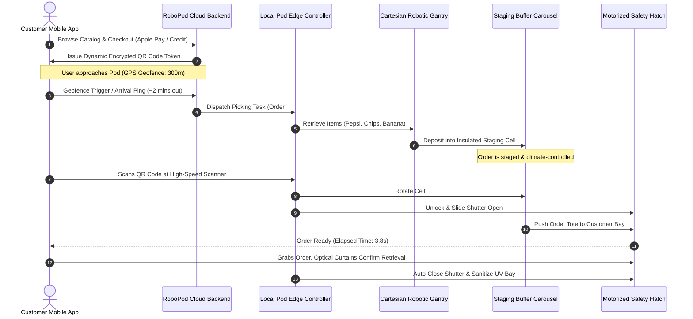

# RoboPod 24/7: Mobile App, QR Pre-Order & 5-Second Dispense Architecture

---

## 1. The 5-Second Pickup Engineering Challenge

A standard robotic retrieval cycle takes **20 to 35 seconds** to traverse shelves, pick 3 to 4 diverse items across multiple temperature zones, and convey them to the hatch. 

While 30 seconds is fast for a walk-up customer, stadium crowds and busy downtown commuters demand **near-instant gratification**. To achieve an **under 5-second pickup**, the system uses **Predictive Pre-Staging with an Internal Multi-Cell Buffer Carousel**.

```
+-----------------------------------------------------------------------------------+
|                         5-SECOND PRE-ORDER PICKUP TIMELINE                        |
|                                                                                   |
|  [Customer 500m Away]     [Geofence Breach (~2 Min)]       [Arrival at Pod]       |
|  Customer orders on app   Cloud triggers robot:            Customer scans QR      |
|  Selects Pepsi, chips,    Gantry picks & places items      Hatch opens instantly  |
|  banana & sandwich.       into Internal Chilled Buffer.    Order presented!       |
|            |                          |                          |                |
|            v                          v                          v                |
|       T - 5 Mins                 T - 2 Mins                   T = 0s              |
|                                                          (Dispense in 3-5s)       |
+-----------------------------------------------------------------------------------+
```

---

## 2. Technical System Workflow



---

## 3. Hardware Architecture: The Pre-Staging Buffer Mechanism

Behind the front dispense hatches lies the **Rotary Staging Buffer Carousel**:
1. **Multi-Bin Drum Carousel**:
   - A motorized vertical or rotary carousel with **8 to 12 insulated quick-release holding cells**.
   - Maintains a chilled micro-climate (3°C) so dairy, ready-made meals, and cold drinks remain food-safe while staged.
2. **Dynamic Bin Allocation**:
   - When the user's phone enters the geofence (approx. 200–300 meters away), the robot picks the order and loads it into an assigned buffer cell.
   - When the user scans their QR code at the exterior optical scanner:
     - The carousel turns directly to the hatch (0.8s).
     - The motorized hatch opens (1.2s).
     - A pneumatic pusher or silicone roller belt ejects the order tote directly to the customer (1.5s).
     - **Total physical dispense time: ~3.5 seconds**.
3. **No-Show / Cancellation Safety Protocol**:
   - If a customer fails to scan their QR within 20 minutes of pre-staging:
     - The system sends a push notification reminder.
     - If unclaimed after 35 minutes, the robot clears the staging cell: ambient goods are returned to inventory; perishables are moved to an internal quarantine bin to guarantee 100% freshness for subsequent buyers.

---

## 4. Dual Kiosk vs Mobile App UX Comparison

| Feature | Walk-Up On-Site Touchscreen | Mobile App (iOS / Android) |
| :--- | :--- | :--- |
| **Primary User** | Spontaneous park visitors, tourists, late-night walk-ups | Regular commuters, stadium fans, office workers |
| **Ordering Process** | Browse 32" anti-glare touch display, filter categories | Full catalog browsing on personal phone anywhere |
| **Payment Method** | Tap-to-Pay (Apple Pay, Google Pay, Interac Flash, Visa/MC) | In-app stored card, Apple Pay, Google Pay, 1-Click Pay |
| **Fulfillment Time** | 20 to 30 seconds (Live picking after payment) | **Under 5 seconds** (Pre-picked into buffer carousel) |
| **Queue Impact** | Up to 2 simultaneous users on dual screens | Zero wait; customers walk directly to QR scanner & grab order |
| **Promotions & Loyalty** | Receipt via SMS / QR code | Push notifications, loyalty points, re-order favorites |

---

## 5. Physical Kiosk Facade & Sensor Layout

```
+-------------------------------------------------------------------------------+
|                       FRONT FACADE INTERACTION ZONES                          |
|                                                                               |
|  +------------------------------+           +------------------------------+  |
|  |   STATION A: TOUCHSCREEN     |           |    STATION B: TOUCHSCREEN    |  |
|  |                              |           |                              |  |
|  |     [ 32" HD Display ]       |           |      [ 32" HD Display ]      |  |
|  |    Sunlight-Readable 2500nit |           |    Sunlight-Readable 2500nit |  |
|  |    IK10 Shatterproof Glass   |           |    IK10 Shatterproof Glass   |  |
|  |                              |           |                              |  |
|  |  +------------------------+  |           |  +------------------------+  |  |
|  |  | Tap / Chip POS Terminal|  |           |  | Tap / Chip POS Terminal|  |  |
|  |  +------------------------+  |           |  +------------------------+  |  |
|  |  | [QR Code Scanner Port] |  |           |  | [QR Code Scanner Port] |  |  |
|  +------------------------------+           +------------------------------+  |
|                 |                                          |                  |
|                 v                                          v                  |
|  +------------------------------+           +------------------------------+  |
|  |     DISPENSE HATCH A         |           |       DISPENSE HATCH B       |  |
|  |  - Motorized security door   |           |  - Motorized security door   |  |
|  |  - LED status indicators     |           |  - LED status indicators     |  |
|  |  - Light-curtain safety eyes |           |  - Light-curtain safety eyes |  |
|  +------------------------------+           +------------------------------+  |
+-------------------------------------------------------------------------------+
```

### Safety Features of the Dispense Hatch:
1. **Infrared Light Curtains & Pinch-Sensors**: If a customer's hand or child's fingers are inside the hatch opening, the motorized door will immediately halt and retract.
2. **UV-C Sanitization Pulse**: Between dispenses, a brief 2-second shielded UV-C pulse sanitizes the pickup tray surface.
3. **Weather Gaskets**: Heated perimeter rubber seals prevent rainwater ingress and prevent freezing during Canadian/Northern US winters.
